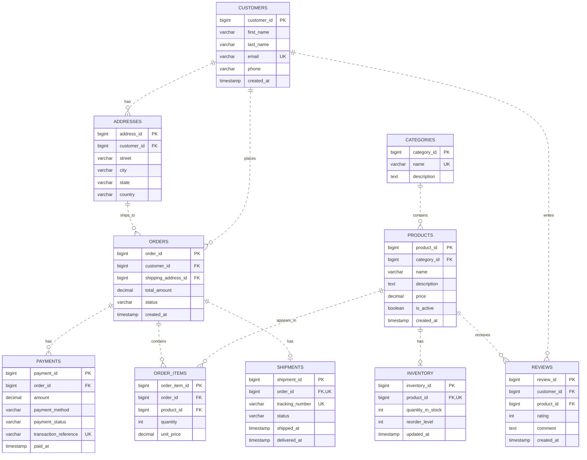

# NexaCart ER Diagram

This diagram shows the relationships enforced by the PostgreSQL schema. Each
child row has exactly one referenced parent. A parent need not yet have child
rows. Dotted lines denote non-identifying relationships: foreign keys are not
part of the child's primary key. `PK`, `FK`, and `UK` identify primary, foreign,
and unique keys. Composite unique constraints are listed below the diagram.

Composite unique constraints:

- `order_items (order_id, product_id)`: a product appears once per order.
- `reviews (customer_id, product_id)`: a customer reviews a product once.

`transaction_reference` and `tracking_number` are nullable; their unique
constraints apply to non-null values. Other nullability, lengths, numeric
precision, defaults, and checks are specified in
[`01-create-schema.sql`](../sql/01-create-schema.sql).

The business intends each stocked product to have inventory and each placed
order to have at least one item. The foreign keys and unique constraints enforce
at most one inventory record and valid item references, but do not require those
child rows to exist. These minimum-participation rules need transaction or
application logic. The original guide's mandatory cardinalities have therefore
been changed here to reflect what the implemented schema actually enforces.

[Rendered diagram](er-diagram.png) is a local Mermaid export of this source, not
a GitHub screenshot. Evidence image `05-erd-render.png` preserves the earlier
GitHub-rendered model; this source and export include the Step 7 corrections.
